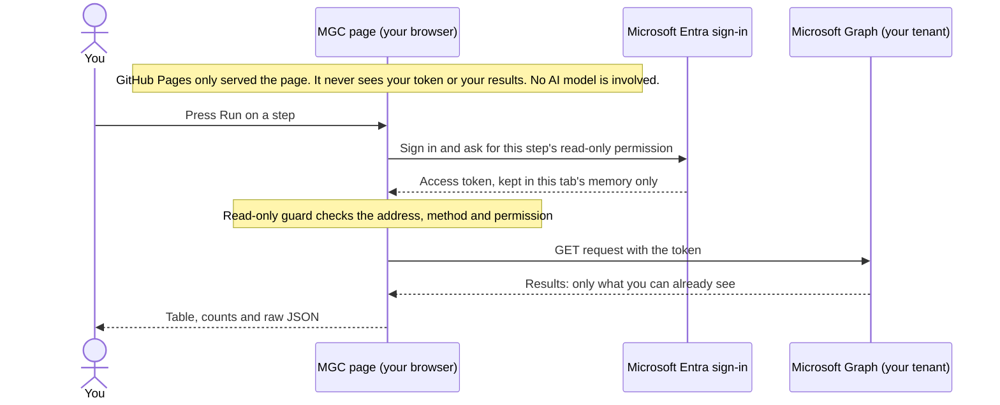
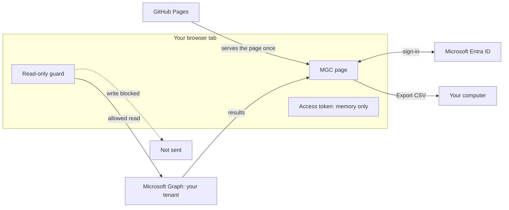

# How the live runner works (Preview)

The live runner lets you run a scenario's read-only steps against your own Microsoft 365 tenant from the MGC page, and see the results there. It is a **preview**, piloted on one scenario: *Oversharing check before Copilot rollout* (`copilot-oversharing`). Open that scenario and press **Run this scenario**. The runner opens on a page of its own (`#run/copilot-oversharing`): where to run it and the steps on the left, the chosen step's results on the right, and the run log underneath. **Back to the scenario** returns to the map.

You can try it without a tenant: **Sample data** runs the same screens on made-up responses for a fictional organisation, Hollowbrook Trading. Nothing is sent, and no permission is asked for.

## In short

- **Read-only.** MGC sends GET requests, plus a few POST requests that only read (Microsoft Search, and reading a file's labels). A read-only guard checks every request before it is sent and blocks anything else.
- **Delegated only.** You sign in as yourself. MGC can only see what your account can already see. It never uses application permissions.
- **Nothing leaves your browser except to Microsoft.** The page calls only Microsoft Entra sign-in (`login.microsoftonline.com`) and Microsoft Graph (`graph.microsoft.com`), and only after you choose to sign in. MGC has no server, sends no analytics or telemetry, and no AI model is involved.
- **Nothing is kept.** The access token stays in the tab's memory. Results stay in the tab, and signing out or closing the tab deletes them. **Export CSV** saves a file on your computer, only when you press it. The browser remembers your tenant and the app (client) ID, and nothing else.

## Where the data goes

One step, from Run to results:



*Text description:* you press Run on a step. The MGC page, in your browser, signs you in with Microsoft Entra and asks for that step's read-only permission. Entra returns an access token, which is kept in the tab's memory only. The read-only guard checks the address, method and permission. The page sends the request with the token to Microsoft Graph in your tenant. Graph returns only what you can already see, and the page shows it as a table, counts and raw JSON.

What crosses where:



*Text description:* GitHub Pages serves the page once. Inside your browser tab are the MGC page, the read-only guard and the access token (memory only). The page signs in with Microsoft Entra ID. The guard lets read requests through to Microsoft Graph, which returns results to the page. A request that could change data is blocked and never sent. Export CSV saves a file on your computer.

The page shows the same two diagrams, as built-in SVG with text descriptions for screen readers, in the explainer that opens before sign-in and behind **How this works** on the Run page. A small version on the Run page lights up the current hop while a request runs.

## Set up: register an app (an admin does this once)

MGC doesn't publish an app of its own. Your organisation registers a single-page app in its own tenant and you give MGC its IDs. Registering an app changes your tenant, so an admin should do it.

1. In the [Microsoft Entra admin center](https://entra.microsoft.com), go to **App registrations** and choose **New registration**. Give it a name such as *MGC live runner*. Under **Supported account types**, choose **Accounts in this organizational directory only**.
2. Under **Redirect URI**, choose **Single-page application (SPA)** and enter the address for where you run MGC:
   - the live site: `https://thatm365guy.github.io/M365-Graph-Cartographer/auth.html`
   - local testing: `http://localhost:8765/auth.html`

   You can add both. They must match exactly.
3. Add **no client secret and no certificate**. Leave the implicit grant options off.
4. Under **API permissions**, add these Microsoft Graph **delegated** permissions, then choose **Grant admin consent**:
   - `Sites.Read.All` (step 1)
   - `Files.Read.All` (steps 2 to 4)
   - `Reports.Read.All` (step 5). This one always needs admin consent ([permissions reference](https://learn.microsoft.com/graph/permissions-reference)).

   Learn lists `Sites.Read.All` and `Files.Read.All` as not needing admin consent, but your tenant's consent settings may still ask for it. Granting it up front avoids a "needs admin approval" stop half-way through.
5. From the app's **Overview**, copy the **Directory (tenant) ID** and the **Application (client) ID**. Each person enters them on the Run page under **My tenant**.

**Give the app read-only permissions only.** Every access token carries all the permissions consented for the app, not just the one a step asks for. MGC reads the permissions in each token and stops, sending nothing, if any of them could change data (anything not ending `.Read` or `.Read.All`, apart from the sign-in ones). Use a separate app registration for MGC rather than reusing one that has other permissions.

Step 5 also needs a reports role on the signed-in account (see below). Without one, Graph answers 403 and the runner says so.

## The steps (checked on Microsoft Learn, 28 Nov 2026)

| Step | Request | Permission (delegated) | What it can't see |
| --- | --- | --- | --- |
| 1. Sites | `GET /v1.0/sites?search={text}` ([Learn](https://learn.microsoft.com/graph/api/site-search?view=graph-rest-1.0)) | Sites.Read.All | Only sites you can open. `getAllSites` needs application permissions. Learn documents searching with a keyword; the default `*` is to be confirmed in a tenant. |
| 2. Sharing links | `$batch` of `GET /v1.0/sites/{id}/drive`, then of `GET /v1.0/drives/{id}/root/permissions` ([Learn](https://learn.microsoft.com/graph/api/driveitem-list-permissions?view=graph-rest-1.0), [batching](https://learn.microsoft.com/graph/json-batching)) | Files.Read.All | Top level of each site's main library only. Learn: a caller who isn't the owner only gets the permissions that apply to them. |
| 3. Sensitive files | `POST /v1.0/search/query` with `entityTypes: ["driveItem"]` and a `path:` filter for each ticked site ([Learn](https://learn.microsoft.com/graph/api/search-query?view=graph-rest-1.0), [files](https://learn.microsoft.com/graph/search-concept-files)) | Files.Read.All | Only files you can open; MGC reads at most 100 results per site. |
| 4. Labels | `POST /v1.0/drives/{id}/items/{id}/extractSensitivityLabels` ([Learn](https://learn.microsoft.com/graph/api/driveitem-extractsensitivitylabels?view=graph-rest-1.0)) | Files.Read.All | Label IDs, not names. Learn notes that it can refresh the label details SharePoint keeps for the file; it doesn't change the file or its label. Locked files (for example double key encryption) return 423. **Applying a label (`assignSensitivityLabel`) is never sent.** |
| 5. Copilot usage | `GET /v1.0/copilot/reports/getMicrosoft365CopilotUsageUserDetail(period='D28')` ([Learn](https://learn.microsoft.com/microsoft-365/copilot/extensibility/api/admin-settings/reports/copilotreportroot-getmicrosoft365copilotusageuserdetail)) | Reports.Read.All | Copilot-licensed users only. Delegated callers need a role: Learn lists Company Administrator, AI Administrator, Exchange Administrator, SharePoint Administrator, Lync Administrator, Teams Service Administrator, Teams Communications Administrator and Reports Reader. The v1.0 report returns CSV text from graph.microsoft.com itself. |

Each step carries its results forward with ticks: step 1's sites go to step 2, step 2's sites (those with anyone or organisation-wide links ticked) go to step 3, and step 3's files go to step 4. You choose what carries forward.

## The read-only guard

One function (`web/live/guard.js`) checks every request before it is sent, in sample runs too. It allows:

- only `https://graph.microsoft.com/v1.0/…` or `/beta/…` (the address is parsed first, so `..` tricks and look-alike hosts fail)
- `GET` with no body
- `POST` to a path on the read-only allow list, `scripts/allowlist.json`. The scenario scripts use the same file, so the two can't drift apart.
- `POST /$batch` only when every request inside it is a `GET` to a relative Graph path, with no body and at most 20 requests
- only permissions whose names end `.Read` or `.Read.All`

Anything else is refused before it is sent, with the reason in plain words, and appears in the run log as **blocked**. **Try a blocked request** on the Run page shows it refusing a `DELETE`. A `@odata.nextLink` is checked like any other address.

Sign-in itself goes through MSAL (below), which also asks for `openid`, `profile` and `offline_access` so you can sign in and stay signed in for the session. Those are sign-in permissions, not Graph data permissions.

## Sign-in, tokens and storage

- **MSAL.js** (`@azure/msal-browser` 5.29.1) is built into the page from `vendor/msal-browser/5.29.1/`, with checksums in `checksums.json` that a test checks. Nothing is loaded from a CDN.
- **Auth code flow with PKCE, in a pop-up.** The page stays as it is, so results already on screen survive each new permission. The pop-up returns to `auth.html`, a small page next to the map that runs only MSAL's redirect bridge, as MSAL v5 requires ([Learn](https://learn.microsoft.com/entra/msal/javascript/browser/login-user)).
- **Memory only.** MSAL uses its memory cache, so access and refresh tokens are gone when you sign out or close the tab. MSAL keeps its short-lived sign-in state (such as the PKCE values for a pop-up in progress, not tokens) in the tab's session storage, as it always does.
- **No telemetry.** MSAL's server telemetry is off and its logger discards everything. Like every MSAL app, it tells Microsoft sign-in its library name and version when it signs you in.
- **Permissions one step at a time.** Before a step that needs a permission you haven't given in this session, the Run page says which permission, why the step needs it, and that it is delegated and read-only. Then Microsoft asks you in its own window.
- **Sign out** forgets the token and the results in MGC. You may still be signed in to Microsoft in the browser.
- The browser keeps three values: `mgc-live-tenant` and `mgc-live-client` (localStorage), and `mgc-live-understood`, the "I understand" tick (sessionStorage, this tab's session only).

## Where it works

Sign-in is offered only on the pages registered as redirect URIs: the live site and `http://localhost:8765/`. Opened as a file, inside an artifact or on any other host (the Azure Function's static website included), the Run page offers sample data only and says why.

To test locally:

```bash
python scanner/build_page.py
python -m http.server 8765 --directory dist
```

Then open `http://localhost:8765/#scenario-copilot-oversharing`.

## Trust and the GitHub Pages address

The live site is `https://thatm365guy.github.io/M365-Graph-Cartographer/`. Browsers treat the whole of `https://thatm365guy.github.io` as one origin, shared by every GitHub Pages site under that account. Any page published there could read the tenant and client ID MGC remembers, open MGC and watch it, or use the registered `auth.html` to get tokens for the app. So publish nothing else on that account's Pages that you don't fully trust. A custom domain (or a separate account) just for MGC would remove this. That needs a GitHub and DNS change, so it is the owner's decision.

## The Content Security Policy

`build_page.py` writes a `<meta http-equiv="Content-Security-Policy">` tag into the page:

| Directive | Value | Why |
| --- | --- | --- |
| `default-src` | `'none'` | Nothing is allowed unless listed below. |
| `script-src` | the SHA-256 hashes of the two inline scripts (MSAL, then the page) | No other script can run. The build computes the hashes. |
| `style-src` | the hash of the `<style>` block | The page has no `style=""` attributes (a test keeps it that way): colours and bar widths are set from script through the CSSOM, which the policy allows. So no `'unsafe-inline'` is needed. |
| `img-src` | `'self' data:` | The favicon is a `data:` image. |
| `connect-src` | `https://login.microsoftonline.com https://graph.microsoft.com` | The only two places the page can send requests. |
| `frame-src` | `'self' https://login.microsoftonline.com` | MSAL's silent sign-in frame, which returns to `auth.html` on the same site. |
| `base-uri`, `form-action`, `object-src` | `'none'` | Hardening. |

"Download script" and "Export CSV" create Blob downloads, which the policy doesn't affect. A meta tag can't set `frame-ancestors`, and GitHub Pages can't set headers, so the page can still be framed by another site. Sign-in is refused inside a frame for that reason.

`auth.html` has its own policy: `default-src 'none'` plus the hashes of its two scripts.

## When something goes wrong

| What happens | What the runner says |
| --- | --- |
| A request that could change data | Blocked by the read-only guard, with the reason. Nothing is sent. |
| 403 | Graph refused: your account doesn't have access. Step 5 lists the reports roles. |
| 429, 503 or 504 | Graph is busy. The runner waits for the time Graph asks (`Retry-After`) and tries up to three times. Throttled requests inside a batch are retried in a new batch. |
| Sign-in expired | Sign out, sign in again, then run the step. |
| Needs admin approval | Ask an admin to grant admin consent on the app registration. |
| Pop-up blocked | Allow pop-ups for the site, then try again. |
| The app has a permission that can change data | MGC stops and sends nothing. Remove that permission, or register a separate app for MGC. |
| Graph answers with a redirect | MGC doesn't follow it and says so. |
| 423 on step 4 | The file is locked (for example double key encryption), so its labels couldn't be read. |

## Owner's test in a dev tenant (before merging)

Run these yourself. Claude Code doesn't run anything against a tenant.

1. Register the app as above, with both redirect URIs.
2. Build and serve locally (above), or merge and use the live site.
3. Open the scenario, press **Run this scenario**, then choose **My tenant**. Read the explainer and tick **I understand**.
4. Enter the tenant and client ID and sign in.
5. **Run all read-only steps.** Check every permission prompt, the results, the ticks and the run log.
6. **Try a blocked request.** The run log shows it as blocked, and nothing appears in the browser's network tools.
7. Get a **403**: run step 5 with an account that has no reports role.
8. **Export CSV** from one step and open the file.
9. **Sign out.** Results and the run log are cleared, and running a step asks you to sign in.
10. Note what worked and what didn't below.

## Pilot findings (for the owner to fill in)

The decision on other scenarios rests on three questions:

- Is the setup (app registration, admin consent, a reports role) too much for the audience?
- Are the results useful, given the delegated-only limits (especially step 2)?
- Is any step misleading?

| Date | What worked | What didn't | Decision |
| --- | --- | --- | --- |
| 28 Nov 2026 | The owner ran the whole checklist in a dev tenant (app registration, every step, a blocked request, a 403 on step 5, sign-out): all of it worked. | Nothing reported. | Merge as v0.11.0 (Preview). Other scenarios, and a custom domain for the live site, are still to decide. |
