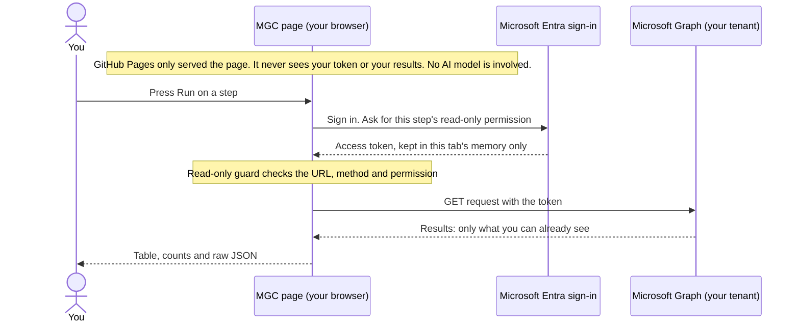
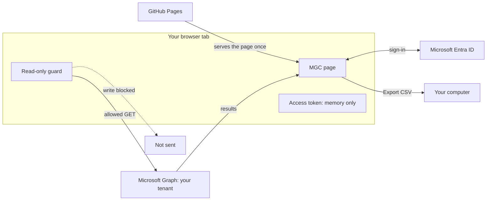

# MGC: plan to map all of Microsoft Graph

Exported from the owner's Claude Doc "MGC: Claude Code brief to map all of Microsoft Graph" and saved here so later sessions can read it. This file is the source of truth for the work. Keep the progress and decisions sections up to date.

## Progress

- [x] Phase 0: git pull and tidy-up (28 Nov 2026)
- [x] Phase 1: make the ring cope with volume (branch `claude/phase1-ring-volume`; merged into `main` 28 Nov 2026, PR #5)
- [x] Phase 2: generated tier, proved on Intune (branch `claude/phase2-generated-intune`; merged 28 Nov 2026, PR #6)
- [x] Phase 3: every v1.0 area, then beta (branch `claude/phase3-all-areas`; merged 28 Nov 2026, PR #7, merge commit f686d15)
- [x] Phase 4: curated depth for security (branch `claude/phase4-security-depth`; merged 28 Nov 2026, PR #8, merge commit 2df0557; the owner approved all six scenarios)
- [x] Phase 5: extras (branch `claude/phase5-extras`; merged 28 Nov 2026 with Phase 6 in PR #9, merge commit 7b5658b)
- [x] Phase 6: nine new scenarios (branch `claude/phase6-scenarios`; merged 28 Nov 2026, PR #9, merge commit 7b5658b)
- [x] Phase 7: script examples for every scenario (branch `claude/phase7-scripts`; merged 28 Nov 2026, PR #11, merge commit 4884c2e; no script is marked Tested yet)
- [x] Code review fixes (`claude/review-fixes`; merged 28 Nov 2026, PR #12) and the polish release v0.10.0 (`claude/polish-header-icons`; merged 28 Nov 2026, PR #14, merge commit d77010c)
- [ ] Phase 8: live read-only runner, piloted on `copilot-oversharing` (branch `claude/phase8-live-runner`, cut from `main` at cf169a2; built 28 Nov 2026 as v0.11.0; waiting for the owner to read the wording and run it in their dev tenant)

## Decisions and findings

- 28 Nov 2026, Phase 0: local `main` fast-forwarded from `fceca84` to `f0f3a58` (Scan 2026-11-23). Worktree `expanding-ring-redesign-b0cccb` removed and its merged branch deleted; its empty folder stayed behind, locked by another process. The stray folder `fix-pointer-freeze-0370c6` held only a `.claude/launch.json` for a worktree that no longer exists. Coverage figures after the pull match the brief exactly. `.claude/worktrees/` was only ignored through `.git/info/exclude`, so `.claude/` was added to `.gitignore` in Phase 1.
- 28 Nov 2026: owner said go for Phase 1.
- 28 Nov 2026, Phase 1 (Claude's choices, open to the owner's review):
  - The six new services are checked against v1.0 `$metadata` (scan of 23 Nov 2026 plus a fresh download on 28 Nov: 1,264 entity types). Each root exists: `/policies` (policyRoot), `/communications` (cloudCommunications), `/solutions` (solutionsRoot), `/education` (educationRoot), `/admin` (admin), `/deviceManagement` and `/deviceAppManagement`. Sub-service names follow those roots' navigation properties.
  - They are marked `planned: true` and have no nodes yet. The build allows empty sub-services only for planned services; the page draws them hollow and dashed ("Not mapped yet").
  - Families: Policies is identity; Communications, Solutions and Education are collaboration; Admin & service health and Devices (Intune) are security and compliance. No new family was added.
  - Learn's `solutionsRoot` page describes only cross-tenant migration, but v1.0 `$metadata` also has `bookingBusinesses`, `bookingCurrencies`, `backupRestore` and `virtualEvents` under `/solutions`. The map follows `$metadata`. Learn's major-services page still calls the Backup Storage API preview.
  - The `/identity` area (58 v1.0 types: Conditional Access root, External ID user flows, identity providers, custom authentication extensions) has no service of its own yet. Proposed: Conditional Access under Policies, the rest as an "External ID & sign-up" sub-service under Identity & directory. Decide in Phase 3.
  - Existing nodes that may move into the new services (not moved; owner to decide): Conditional Access policy (Identity › Access & risk → Policies › Conditional Access), online meeting (Teams › Meetings → Communications › Online meetings), message trace (Outlook › Exchange admin → Admin › Exchange, SharePoint & Teams admin), subscribed SKUs (Identity › Directory → Admin).
  - Ring cap: 8 bubbles per open sub-service (7 APIs plus "+n more" when there are more than 8). Service bubbles stop growing at 14 APIs so 16 services fit on the first ring.
  - Coverage: "mapped" = on the map (either tier), "curated" = hand-written entries. Both are 137 of 1,264 until the generated tier lands.
- 28 Nov 2026: owner said go for Phase 2. Phase 1 was pushed but not merged, so Phase 2 is cut from `claude/phase1-ring-volume`, not from `main`.
- 28 Nov 2026, Phase 2 (Claude's choices, open to the owner's review):
  - `permissions/new/permissions.json` exists and has the expected shape: `{"$schema", "permissions": {name: {"authorizationType", "schemes", "pathSets": [{"schemeKeys", "methods", "paths": {lowercase path: "least=<schemes>" | "" | "AlsoRequires=..."}}], "ownerInfo"}}}`, 975 permissions. The scanner checks this shape on every read and refuses a file that differs.
  - The catalogue often marks both a Read and a ReadWrite permission as least privileged for the same GET (106 of 129 Intune entries). The page lists every name marked least, in name order, under "generated, not checked", and does not choose between them.
  - The pin is the catalogue repository's HEAD commit, read from git's public refs endpoint, because the REST API's anonymous limit (60 calls an hour) ran out during this phase. The Learn index still needs two REST calls; `GITHUB_TOKEN` (if the workflow passes it) or `--docs-index` avoids the limit. Passing `GITHUB_TOKEN` in `.github/workflows/scan.yml` is a workflow change, so it is left for the owner.
  - Generated entries are built for every v1.0 type and saved in `data/generated.json`; only the areas in `data/placement.json` reach the map. Phase 3 can then extend placement with `--no-scan`.
  - Variants: a type that no root reaches folds into its nearest ancestor that one does (80 Intune variants, for example 26 device configuration platforms and 26 mobile app types). Labels say "(n variants)" rather than "platforms", because mobile app variants are app kinds, not platforms.
  - Learn links only when exactly one resource page fits the type name; 6 of 129 Intune entries have none (deviceManagement, deviceAppManagement, deviceCategory, deviceCompliancePolicyState, deviceConfigurationState, mobileAppContentScript).
  - 15 of 129 Intune entries have no GET entry in the catalogue (mostly nested paths, Cloud PC assignments, `/deviceManagement/virtualEndpoint`). Left blank.
- 28 Nov 2026: owner said go for Phase 3. Phase 2 was pushed but not merged, so Phase 3 is cut from `claude/phase2-generated-intune`.
- 28 Nov 2026, Phase 3 (Claude's choices, open to the owner's review):
  - Result: all 1,264 v1.0 types and all 1,369 beta-only types are placed. `placement.json` now lists `"areas": ["*"]`, so any new Graph area that no rule places fails the build.
  - Unrooted types: area assignment and paths now follow bound operation return types (15 types, for example `aiInteraction` and `exchangeMessageTraceDetail`), then plain relationships, then (areas only) an abstract base takes its derived types' area. Navs typed as `entity` are ignored, because they "reach" everything. 14 v1.0 types still have no area and are placed by `type` rules. `entity` itself is covered by the Graph hub (`hub.covers`), so curated counts 138 rather than 137.
  - 16 new sub-services, all inside existing services (still 16 services): Identity › External ID & guests, Tenant & organisation; Outlook › Places (rooms & desks); Files › OneNote, SharePoint Embedded & storage; Teams › Shifts & schedules, Teams apps & admin; Security › Threat intelligence, Attack simulation & training, Defender for Identity, Global Secure Access; Solutions › Viva learning & engagement, Universal Print, Business Central financials; Admin › Change notifications & extensions; AI › Copilot connectors & search. Names checked: "Microsoft 365 Copilot connectors (formerly Microsoft Graph connectors)", "Attack simulation and training" (Defender for Office 365), Global Secure Access and Business Central appear under those names on Learn.
  - Judgement calls to review: per-user authentication methods (`/users/{id}/authentication`) sit with Policies › Authentication; `/admin/exchange` and the beta message trace roots sit with Outlook › Exchange admin (next to the curated message trace node); Universal Print and Viva sit under Solutions; Entra access drift and tenant governance metrics sit under Identity › Tenant & organisation; Entra Permissions Management types (AWS, GCP, Azure permission definitions, beta) sit under Identity › Access & risk.
  - The six Phase 1 services are no longer `planned`: every sub-service now holds at least one API.
  - Ring: sub-service bubbles stop growing at 14 APIs, like services; six long sub-service names got a `short` ring name.
  - Beta-only generated entries are hidden until Filter › Beta-only APIs (generated) is on. No Learn link for them (the index lists v1.0 pages only).
  - The page is now 2.1 MB (generated entries about 1.6 MB). GitHub Pages serves it compressed. If it needs to shrink, the property lists of generated entries are the first candidate.
  - Nine catalogue permission names are not in the stored permission list (fetched 16 Nov), for example `Zone.Read.All`; the page flags them. A `--permissions` run would refresh the list.
- 28 Nov 2026: owner merged PRs #5, #6 and #7 into `main` (live, deploy run green). Owner pulled locally; Phase 4 is cut from `main`.
- 28 Nov 2026, Phase 4 (curated depth for security):
  - 12 curated nodes, every permission, licence and limit checked on Microsoft Learn on 28 Nov 2026, every path, relationship and Learn page checked against $metadata and the docs index: authentication method, user registration details (Policies › Authentication); risk detection, risky service principal (Identity › Access & risk); cross-tenant access policy (Policies › Cross-tenant access); managed device, device compliance policy (Devices); attack simulation, Secure Score control profile (Security); service health issue, Message centre post (Admin › Service health); provisioning log (Reports › Sign-in & audit logs). 12 curated links (one, user → managed device, was found by the scanner and curated).
  - Left blank because Learn doesn't state it on the API pages: licence for authentication methods, cross-tenant access policy, Secure Score control profiles, service health and Message centre.
  - Facts recorded as Learn states them, though they look odd: List riskDetections says Entra ID P1 or P2 (the existing risky user node says P2 for full data).
  - Curated now covers 153 of 1,264 v1.0 types (12%).
  - Known cosmetic issue, not fixed: a "→ API" link tag can sit over service labels on the left of the ring (seen with the compliance policy selected). MGC.check doesn't cover link tags.

#### Phase 4 scenarios (owner approved all six on 28 Nov 2026; written into curated.json)

Each step names the node and what to do; the call, permission and catch default to the node's own notes. Filters marked "to confirm" must be checked on Learn before the scenario is written.

1. **Compromised workload identity triage** (Classic): risky service principal (list atRisk, Workload ID Premium) → service principal (owners, credentials) → app role assignment (what it can do) → sign-in (service principal sign-ins, filter to confirm) → directory audit (recent changes to the app).
2. **Risky sign-in investigation** (Classic): risk detection (riskEventType, IP, location) → risky user (state, history) → sign-in (the request behind the detection, join to confirm) → authentication method (was a new method registered?) → directory audit (method and role changes).
3. **Device compliance gap behind Conditional Access** (Classic): device compliance policy (which policies and platforms) → managed device (complianceState, last sync) → device (join by azureADDeviceId = deviceId) → Conditional Access policy (which policies require a compliant device).
4. **Phishing simulation follow-up** (Classic): attack simulation (campaigns and results) → repeat offenders report (/reports/security/getAttackSimulationRepeatOffenders) → user → user registration details (are repeat offenders MFA capable?) → risky user.
5. **Provisioning failure review** (Classic): provisioning log (failures, filter on provisioningStatusInfo/status to confirm) → service principal (the provisioning app) → user (the target identity) → directory audit.
6. **Weekly posture and change review** (Classic): Secure Score → Secure Score control profile (open improvement actions) → Message centre post (action-required changes) → service health issue (open incidents).

Checks made before writing them (Microsoft Learn, 28 Nov 2026): the service principal sign-in filter `signInEventTypes/any(t: t eq 'servicePrincipal')` is only documented in beta, so step 4 of scenario 1 uses the beta endpoint and says so. `provisioningStatusInfo` isn't documented as filterable in v1.0, so scenario 5 filters on `activityDateTime` and picks out failures in code. A risk detection's `correlationId` is the sign-in's correlation ID and `signIn` supports `$filter` on it, so scenario 2 joins on that (and a curated link records it). The repeat offenders report needs `AttackSimulation.Read.All`. Every property the steps name (complianceState, azureADDeviceId, deviceId, isCompliant, actionRequiredByDateTime, isResolved) was checked against $metadata. Scenario ids: workload-identity-triage, risky-signin-investigation, device-compliance-gap, phishing-simulation-followup, provisioning-failure-review, posture-change-review.

Overlap with Phase 6: Phase 6 scenario 2 (phishing-resistant MFA migration) and scenario 6 (Conditional Access coverage) will also use user registration details, authentication method and cross-tenant access policy, so they are not proposed again here.
- 28 Nov 2026: owner merged PR #8 (Phase 4) into `main`; deploy green, live page serves curated 0.8.0 with the six new scenarios.
- 28 Nov 2026, Phase 5 (extras):
  - "Open in Graph Explorer" on every entry with a GET path: 76 of 85 curated and 1,671 of 1,835 generated entries. The link format (`https://developer.microsoft.com/graph/graph-explorer?request=<encoded path>&method=GET&version=<v1.0|beta>&GraphUrl=https://graph.microsoft.com`) is the one Learn's own "try it" links use; checked that it opens with the request filled in (nobody signed in, nothing run). The link uses the entry's first request, simplifies placeholders such as `{id | userPrincipalName}` to `{id}`, takes the version from a `/beta` prefix or the scan status, and adds a note when placeholders need filling. POST-only entries (for example `runHuntingQuery`) and entries outside Graph get no link, so every link is read-only.
  - Permission names link to `https://graphpermissions.merill.net/permission/<name>` (checked: real pages load, including hyphenated names; a made-up name doesn't resolve). Only names the scanner has confirmed against Graph's permission list are linked (441 distinct names), in curated and generated panels and in scenario steps.

---

## Brief

Brief for Claude Code, to run in `C:\Users\tomo9\Desktop\Tech-Stuff\Claude\MGC`. It takes M365 Graph Cartographer from 137 to all 1,264 v1.0 types, starting with a git pull and tidy-up. The phases are under Tasks for Claude Code.

### Where it stands

MGC is live with the expanding ring, but it maps 137 of 1,264 v1.0 resource types: about 11% of Microsoft Graph.

- **Live since 16 Nov 2026.** The expanding ring, sub-services, the one-row header and the scenarios went out in PR #4. The weekly scan ran on 23 Nov and worked: it picked up new Agent identity properties and two print types promoted from beta to v1.0.
- **Coverage.** The 73 curated resources cover 137 v1.0 types and touch 28 of 132 Graph areas. Only 5 of 1,368 beta-only types are on the map. Purview stands at 41 of 62, and identity governance at 49 of 84.
- **Housekeeping.** The local MGC folder is still at the 16 Nov morning version. The redesign is on GitHub but was never pulled locally, and the Claude Code worktree is parked on an old branch. Run `git pull` on main and `git worktree remove` before the next build.

Biggest gaps, from `data/coverage.json` (scan of 23 Nov 2026):

| Graph area | v1.0 types | On the map |
|---|---:|---:|
| deviceManagement (Intune devices) | 134 | 0 |
| security | 100 | 36 |
| users | 87 | 13 |
| sites | 76 | 6 |
| deviceAppManagement (Intune apps) | 75 | 0 |
| solutions (Bookings, Backup and others) | 59 | 0 |
| identity | 58 | 0 |
| policies | 57 | 1 |

A further 89 v1.0 types are unrooted: no path reaches them from a root, so the scanner can't place them.

### Why mapping everything needs a different approach

Hand-writing an entry for every one of the 2,632 types isn't realistic, and a ring with that many bubbles would be unreadable.

Each entry so far has a hand-written summary, permissions, limits and licensing, all checked against Microsoft Learn. Many types also aren't separate APIs. In the two Intune areas, 74 of the 209 v1.0 types are Android, iOS or Windows versions of the same policy. Others are base types or settings objects.

### Design: two tiers

Every v1.0 type gets a generated entry from the schema, and curated entries add depth on top.

**Generated tier:** everything, built by the scanner.

- Every addressable resource gets an entry from `$metadata`: path or paths from a root, v1.0 or beta, properties, navigation properties, bound actions and functions.
- Platform variants are folded into their base type as one entry, for example "Compliance policy (13 platforms)". The variant names stay in its detail.
- A rules table in a new file, `data/placement.json`, puts each entry in a service and sub-service, by root path first and then by namespace or area. The build fails on any v1.0 type that no rule places.
- Permissions come from Microsoft's path-to-permission catalogue: `permissions/new/permissions.json` in `microsoftgraph/microsoft-graph-devx-content`, refreshed in a weekly sync. Mark them "generated, not checked", because Microsoft's own reviews of that file flag least-privilege errors.
- Each entry links to its Microsoft Learn page where one can be found. No summaries, limits or licensing are made up for generated entries.

**Curated tier:** what `curated.json` holds now. Hand-written summaries, limits, licensing and scenarios. A curated entry overrides the generated entry for the same type. The page shows a badge saying which tier an entry comes from.

Completeness becomes a build rule, like the sub-service rule: the build fails if any v1.0 type is unplaced. That keeps the map complete as Graph grows each week. Beta-only types are placed too, but stay hidden behind a Filter switch that is off by default.

### Tasks for Claude Code

Work through the phases in order. Stop and report at the end of each phase, and wait for the owner's go-ahead before starting the next.

#### Ground rules

- Read CLAUDE.md first and follow it.
- Work on a new branch per phase, cut from an up-to-date main. A push to main deploys the live site, and mgc-bot also commits to main after each scan.
- Stop and ask before any push, PR, workflow change, GitHub setting or Azure change. Commit locally, then give the owner the commands to push.
- Never invent permission names, API paths, limits or licensing. Leave a gap blank and list it in the report.
- No tenant data in the public build.

#### Phase 0: git pull and tidy-up

The local folder is behind GitHub. Local main is at `fceca84`, from the morning of 16 Nov. `origin/main` is at `f0f3a58` (Scan 2026-11-23) and includes PR #4. The worktree `.claude/worktrees/expanding-ring-redesign-b0cccb` is checked out on an old branch.

```
git status
git switch main
git fetch --prune
git pull --ff-only
git worktree list
git worktree remove .claude/worktrees/expanding-ring-redesign-b0cccb
git worktree prune
git branch --merged main
git branch -d claude/expanding-ring-redesign-b0cccb
```

- Stop if `git status` shows uncommitted changes, and report them. Don't stash or discard anything.
- `git branch -d` only deletes merged branches. If it refuses, report it, and don't use `-D` without asking.
- The folder `.claude/worktrees/fix-pointer-freeze-0370c6` isn't a registered worktree. Check that it holds nothing missing from main, then ask before deleting it.
- Check that `.claude/worktrees/` is in `.gitignore`.
- Check the result: main equals origin/main, `git worktree list` shows one entry, and the tests pass.

#### Phase 1: make the ring cope with volume

- Cap each open sub-service on the ring at about 8 bubbles: curated entries first, then the most-linked generated ones. A final "+n more" bubble opens a searchable, sortable list in the side panel, and picking a row selects that entry.
- Add services for the new areas. Proposed: Devices (Intune), Admin & service health, Policies, Communications, Solutions (Bookings, Backup, Virtual events) and Education. Put each in a family and give it a shade, and propose sub-services for each in the report.
- Keep every label check passing with 16 services. Re-run `MGC.check()` and the Playwright checks at 1440×900, 1280×800 and 1280×720.
- Change Coverage so it shows mapped and curated as separate figures.

#### Phase 2: generated tier, proved on Intune

- Read `permissions.json` from `microsoftgraph/microsoft-graph-devx-content` in the scanner. Pin the commit it used in `meta.scan`. If the file's shape doesn't match what's expected, stop and report.
- Build generated entries for deviceManagement and deviceAppManagement (209 v1.0 types, none on the map today), with platform variants folded together.
- Add `data/placement.json` and the build rule, starting with the two Intune areas.
- Add tests for the variant folding, the placement rules and the curated-over-generated override.

#### Phase 3: every v1.0 area, then beta

- Extend `placement.json` to every v1.0 area, until the build rule passes for all 1,264 types.
- Follow function return types (for example `getAllEnterpriseInteractions` to `aiInteraction`), so the 89 unrooted types get placed.
- Add beta-only types behind a Filter switch that is off by default.

#### Phase 4: curated depth for security

Add curated entries, checked against Microsoft Learn, in this order:

1. authentication methods and registration details
2. risk detections and risky service principals
3. cross-tenant access policy
4. Intune managed devices and compliance policies
5. attack simulation and Secure Score control profiles
6. service health and Message centre
7. provisioning logs

Propose new scenarios that use them.

#### Phase 5: extras

- An "Open in Graph Explorer" link on each entry.
- A link from each permission to graphpermissions.merill.net.

#### Report at the end of each phase

- What changed, file by file.
- Anything left blank or uncertain.
- New coverage figures.
- The commands to view the build locally.
- The git commands for the owner to push the branch and open a PR.

### Sources

- microsoft-graph-devx-content: Weekly Permissions sync 2026-10-21 (PR #1666)
- microsoft-graph-devx-content: Weekly Permissions sync 2026-10-20 (PR #1665)
- microsoft-graph-devx-content: commit b9a67f1, `permissions/new/permissions.json`
- MGC repository: CLAUDE.md, `data/coverage.json` and `data/changelog.json` at `f0f3a58` (Scan 2026-11-23).

#### Phase 6 scenarios (owner approved all nine on 28 Nov 2026; written into curated.json, curated 0.9.0)

Every call, filter, permission and catch below was checked on Microsoft Learn on 28 Nov 2026. Where a step names no permission or licence, it uses the node's own (already checked) notes. "(read-only, uses POST)" marks the few read calls that need POST, for Phase 7's allow list.

**New curated nodes these need** (facts checked; written only after approval):
- **Authentication methods policy** (Policies › Authentication): `GET /policies/authenticationMethodsPolicy`, Policy.Read.AuthenticationMethod (delegated and application); roles Global Reader or Authentication Policy Administrator; not in the China (21Vianet) cloud.
- **Authentication strength policy** (Policies › Authentication): `GET /policies/authenticationStrengthPolicies`, Policy.Read.AuthenticationMethod; built-in "Phishing-resistant MFA" is id `00000000-0000-0000-0000-000000000004` (allowed combinations windowsHelloForBusiness, fido2, x509CertificateMultiFactor); a Conditional Access policy points to it through the `grantControls.authenticationStrength` relationship and can't combine it with the `mfa` control.
- **SharePoint tenant settings** (Admin › Exchange, SharePoint & Teams admin): `GET /admin/sharepoint/settings`, SharePointTenantSettings.Read.All; delegated callers need Global Reader or SharePoint Administrator; `sharingCapability` is disabled, externalUserSharingOnly, externalUserAndGuestSharing or existingExternalUserSharingOnly (Learn's Graph page doesn't say which value allows "Anyone" links).

**Template change:** a fourth scenario group, "Cost and hygiene", for scenarios 8 and 9.

**1. Least-privilege review of apps' and agents' Graph permissions** (`app-permission-review`, Classic). Licence: Entra ID Free for the grants; P1 or P2 for the last-used report.
1. Service principal: find Microsoft Graph's service principal. `GET /servicePrincipals(appId='00000003-0000-0000-c000-000000000000')`. Catch: the appId is the same in every tenant; the object id is not.
2. App role assignment: list every app and agent holding Graph application permissions. `GET /servicePrincipals(appId='00000003-0000-0000-c000-000000000000')/appRoleAssignedTo`, Application.Read.All. Catch: recent grants or removals can show late (replication delay).
3. OAuth2 permission grant: list delegated grants to Graph. `GET /oauth2PermissionGrants?$filter=resourceId eq '{graphSpObjectId}'`, Directory.Read.All. Catch: resourceId is Graph's service principal object id in your tenant, not its appId.
4. Agent identity: pick out the agent identities among the holders (they are service principals of type agentIdentity).
5. Report root: check when each app last signed in. `GET https://graph.microsoft.com/beta/reports/servicePrincipalSignInActivities?$filter=appId eq '{appId}'`, AuditLog.Read.All, P1 or P2. Catch: beta only; Learn says a timestamp alone doesn't prove the sign-in succeeded.

**2. Phishing-resistant MFA migration tracking (passkeys)** (`passkey-migration`, Classic). Licence: P1 or P2 for the registration report and Conditional Access.
1. User registration details: count who is passwordless capable. `GET /reports/authenticationMethods/userRegistrationDetails?$filter=isPasswordlessCapable eq false`. Catch: Learn names `passKeyDeviceBound` as an example `methodsRegistered` value but gives no full list; disabled users aren't returned.
2. Authentication methods policy (new): see which methods, including passkeys (FIDO2), are enabled and for whom.
3. Authentication strength policy (new): confirm the built-in Phishing-resistant MFA strength and any custom strengths.
4. Conditional Access policy: find the policies that require that strength, and who they exclude. Catch: it is the `grantControls.authenticationStrength` relationship, not a built-in control.
5. Authentication method: check stragglers one by one. Catch: Learn advises against this API for whole-population audits.
Not covered in v1.0: how a user actually signed in (`authenticationDetails`) is in beta sign-in logs only.

**3. "Anyone" and organisation-wide sharing link audit** (`sharing-link-audit`, Classic).
1. SharePoint tenant settings (new): read the tenant's sharing level (`sharingCapability`).
2. Site: list every site. `GET /sites/getAllSites`, Sites.Read.All (application only). Catch: no delegated permission; results are paged.
3. Drive item: walk each drive and flag items whose sharing changed. `GET /drives/{id}/root/delta` with `Prefer: deltashowremovedasdeleted, deltatraversepermissiongaps, deltashowsharingchanges`. Catch: Learn says processing permissions this way needs Sites.FullControl.All, a high permission.
4. Permission: list each flagged item's permissions and keep links with `link.scope` anonymous or organization. Catch: the driveItem `shared.scope` property is deprecated; use `/permissions`.
5. Audit log query: find who created and used the links (AnonymousLinkCreated, AnonymousLinkUsed, CompanyLinkCreated). (read-only, uses POST) Catch: Learn doesn't explicitly tie these operations to the SharePointSharingOperation record type, so filter by operation name.

**4. Workload identity hygiene: expiring secrets, unused and over-permissioned apps** (`workload-identity-hygiene`, Classic). Licence: Entra ID Free; P1 or P2 for credential last use.
1. Application: list apps with their secrets and certificates. `GET /applications?$select=id,appId,displayName,passwordCredentials,keyCredentials`, Application.Read.All. Catch: filter `endDateTime` in your own code (no documented `$filter` on expiry); `$select` of keyCredentials is throttled at 150 requests a minute per tenant.
2. Service principal: do the same for service principals, which can hold credentials too.
3. Application: find apps with fewer than two owners. `GET /applications?$filter=owners/$count eq 0 or owners/$count eq 1&$count=true` with `ConsistencyLevel: eventual`.
4. Report root: check when each credential was last used. `GET https://graph.microsoft.com/beta/reports/appCredentialSignInActivities`, AuditLog.Read.All. Catch: beta only; the API page states no licence.
5. App role assignment: list the application permissions each app holds. `GET /servicePrincipals/{id}/appRoleAssignments`.
6. Risky service principal: check whether any are flagged at risk.

**5. Sensitivity label coverage as a Copilot readiness gate** (`label-copilot-readiness`, AI).
1. Sensitivity label: list the labels in use.
2. Group: check container labels on Microsoft 365 groups and their team sites. `GET /groups/{id}?$select=assignedLabels`, Group.Read.All. Catch: needs `$select`; needs Entra ID P1; the site resource has no label property.
3. Site: list every site (`GET /sites/getAllSites`, application only).
4. Drive item: read each file's label. `POST /drives/{id}/items/{id}/extractSensitivityLabels`, Files.Read.All (read-only, uses POST). Catch: driveItem has no label property; the call can refresh the stored label metadata; not supported for SharePoint Embedded; 423 Locked for double key encrypted files.
5. Outside Graph: labelled-versus-unlabelled counts aren't in Graph; they're in Purview content explorer or the SharePoint Advanced Management sensitivity label report.

**6. Conditional Access coverage and gap analysis** (`ca-coverage-gaps`, Classic). Licence: Entra ID P1.
1. Conditional Access policy: list policies with their state and include/exclude lists. Catch: `enabledForReportingButNotEnforced` means report-only.
2. Group: resolve excluded groups, including break-glass accounts. `GET /groups/{id}/members`.
3. Sign-in: find sign-ins that no policy applied to. `GET /auditLogs/signIns?$filter=conditionalAccessStatus eq 'notApplied' and createdDateTime ge {date}`, AuditLog.Read.All plus Policy.Read.ConditionalAccess. Catch: without a policy permission, `appliedConditionalAccessPolicies` is silently left out.
4. Conditional Access policy: test a user and app with What If. `POST /identity/conditionalAccess/evaluate`, Policy.Read.ConditionalAccess (read-only, uses POST). Catch: pass an app ID, not "Office 365"; unset conditions don't match.
5. Cross-tenant access policy: check inbound trust (MFA and device claims) for guests.

**7. EWS to Graph migration of mail-integrated apps** (`ews-migration`, Classic). Catch for the whole scenario: EWS in Exchange Online began phased disablement on 1 October 2026 and is fully retired on 1 April 2027.
1. Outside Graph: start with the EWS usage report in the Microsoft 365 admin center (Reports › Usage › Exchange › EWS usage): app ID, SOAP action, call volume, last activity. Catch: no Graph endpoint; data is aggregated weekly and can lag up to 10 days.
2. Service principal: find Office 365 Exchange Online. `GET /servicePrincipals(appId='00000002-0000-0ff1-ce00-000000000000')`.
3. App role assignment: list apps holding `full_access_as_app` (EWS with access to every mailbox). `GET /servicePrincipals(appId='00000002-0000-0ff1-ce00-000000000000')/appRoleAssignedTo`.
4. OAuth2 permission grant: list delegated grants with `EWS.AccessAsUser.All`. `GET /oauth2PermissionGrants?$filter=resourceId eq '{exchangeSpObjectId}'`.
5. Application: find each app's owners to contact. `GET /applications(appId='{appId}')/owners`.
Guide: https://learn.microsoft.com/graph/migrate-exchange-web-services-overview

**8. ROT clean-up: stale, duplicate and orphaned content** (`rot-cleanup`, Cost and hygiene).
1. Report root: SharePoint site usage, with last activity and storage used. `GET /reports/getSharePointSiteUsageDetail(period='D180')`, Reports.Read.All. Catch: if `displayConcealedNames` is on (`GET /admin/reportSettings`, ReportSettings.Read.All), site and owner names come back hashed.
2. Site: open the stale sites.
3. Drive: check each drive's quota and owner.
4. Drive item: list files with delta and pick out old ones by lastModifiedDateTime. `GET /drives/{id}/root/delta`. Catch: delta has no `$filter`, so filter in your own code.
5. Drive item: count versions on large files. `GET /drives/{id}/items/{id}/versions`. Catch: newest first, no `$orderby`.
6. Retention label: read each file's retention label before anything is marked for deletion. `GET /drives/{id}/items/{id}/retentionLabel`, Files.Read.All. Catch: don't delete if `isDeleteAllowed` is false or the record is locked.
To check before writing: Learn doesn't describe a duplicate-detection method; the step text won't claim one.

**9. Licence clean-up, including Copilot seats** (`licence-cleanup`, Cost and hygiene).
1. Subscribed SKU: compare bought (`prepaidUnits.enabled`) with used (`consumedUnits`). LicenseAssignment.Read.All.
2. User: licensed users with their sign-in activity. `GET /users?$select=id,userPrincipalName,accountEnabled,assignedLicenses,signInActivity`, User.Read.All plus AuditLog.Read.All, P1 or P2. Catch: page size up to 500 with signInActivity; a signInActivity filter can't be combined with other filters; no data before April 2020.
3. User: disabled accounts still holding licences. `GET /users?$filter=accountEnabled eq false and assignedLicenses/$count ne 0&$count=true` with `ConsistencyLevel: eventual`. Catch: this combination follows Learn's documented rules but Learn shows no exact example.
4. Group: group-based licences. Users' `licenseAssignmentStates.assignedByGroup` names the group; `group.assignedLicenses` needs `$select`. Catch: remove the licence from the group, not the user.
5. Report root: Copilot usage per user. `GET /copilot/reports/getMicrosoft365CopilotUsageUserDetail(period='D28')` (v1.0, CSV), Reports.Read.All. Catch: covers Copilot-licensed users only; delegated callers need a role such as AI Administrator or Reports Reader.

---

## Added by the owner on 28 Nov 2026: Phases 6 and 7

Start these only when the owner says go. The same ground rules apply: stop and ask before anything that touches GitHub or Azure, and never invent permission names, API paths or cmdlet names.

- [x] Phase 6: nine new scenarios (branch `claude/phase6-scenarios`, stacked on Phase 5; owner approved all nine on 28 Nov 2026; written and committed locally)
- [x] Phase 7: script examples for every scenario (branch `claude/phase7-scripts`, cut from `main` after PR #10, committed locally 28 Nov 2026; no script is marked Tested yet)

#### Phase 6: nine new scenarios

Add these scenarios, chosen from the owner's ranked list of 50 Graph use cases. Before writing anything into `curated.json`, propose the steps for each one and wait for the owner's approval. Use the same shape as the existing 15: node, what to do, the call, the permission, the catch. They need the curated nodes from Phase 4.

1. Least-privilege review of agents' and apps' Graph permissions
2. Phishing-resistant MFA migration tracking (passkeys)
3. "Anyone" and organisation-wide sharing link audit
4. Workload identity hygiene: expiring secrets, unused and over-permissioned apps
5. Sensitivity label coverage as a Copilot readiness gate
6. Conditional Access coverage and gap analysis
7. EWS to Graph migration of mail-integrated apps
8. ROT clean-up: stale, duplicate and orphaned content. Suggested route:
   1. The SharePoint site usage report (last activity, storage used).
   2. Then site and drive.
   3. Then old files and version counts.
   4. Then each file's retention label, before anything is marked for deletion.
9. Licence clean-up, including Copilot seats. Suggested route:
   1. Subscribed SKUs (bought against used).
   2. Then licensed users with their sign-in activity.
   3. Then disabled accounts that still hold licences.
   4. Then group-based licence assignments.
   5. Then Copilot usage.

Add a fourth scenario group, "Cost and hygiene", for 8 and 9.

#### Phase 7: script examples for every scenario

Every scenario gets a script that people can run themselves: the 15 that exist and the 9 from Phase 6. Read-only scripts come first. Scripts that change things are out of scope for this phase.

1. Format.
   - Each step keeps its HTTP call and gains its Microsoft Graph PowerShell equivalent (Microsoft.Graph SDK v2, PowerShell 7).
   - Each scenario also gets one full script in `scripts/scenarios/<scenario-id>.ps1`. It runs the scenario's read-only steps from start to finish and writes the results to a local CSV file.
2. Read-only rules.
   - `Connect-MgGraph` asks only for the least-privileged delegated `.Read` scopes the steps need.
   - Only `Get-Mg*` cmdlets and `Invoke-MgGraphRequest -Method GET` are allowed.
   - A few read-only calls use POST, such as `runHuntingQuery` and creating an `auditLogQuery`. Put each one on an allow list and label it "read-only, uses POST".
   - Nothing is sent anywhere except Microsoft Graph, and no tenant data goes into the repository.
3. Script header. Each script starts with:
   - its purpose
   - the scopes it needs
   - the Entra roles it needs
   - the licence it needs
   - its parameters, with safe defaults (for example `-DaysInactive 90`)
   - what it doesn't do
   - a link to its scenario on the live site
4. Checks in the tests.
   - Every cmdlet must exist in the Microsoft.Graph modules and match its step's call. Use `Find-MgGraphCommand` for this.
   - PSScriptAnalyzer must report no errors.
   - A guard fails the build on any `New-`, `Set-`, `Update-`, `Remove-` or `Add-` cmdlet, or on any non-GET request that isn't on the allow list.
5. Page.
   - The scenario walk gets an HTTP / PowerShell switch on each step, with a Copy button.
   - Each scenario gets a "Download script" link.
   - A short note says the scripts are examples to read before running, and are provided as-is.
6. Testing.
   - A script is marked "Tested" only after the owner has run it in their own dev tenant. Record the date.
   - Don't run scripts against any tenant yourself. Give the owner the exact commands to run.
7. Later, not now. A separate remediation tier of write scripts, with `-WhatIf` on by default and a clear warning.

#### Phase 7 decisions (28 Nov 2026)

- **One script per scenario, all 30** (21 before Phase 6 plus the 9 from Phase 6), in `scripts/scenarios/<scenario-id>.ps1`, written as one CSV per step into a dated folder. Every script shares the same small helpers (paging, safe property reads, one CSV per step, a failed step warns and the script goes on) so each file stands alone for download.
- **Steps that change data are left out** and named in the header. Where a read gives the same picture, the script reads instead: risk state instead of confirmCompromised, existing retention events instead of creating one, and for the legal hold scenario (every step writes) an overview of existing cases, custodians, holds, searches and review sets.
- **Application-only steps** (getAllSites without `-SiteId`, getAllEnterpriseInteractions) are skipped with a message in a delegated session; `-UseExistingConnection` runs them in an app-only session.
- **Allow list** (`scripts/allowlist.json`): runHuntingQuery, auditLog/queries, extractSensitivityLabels, conditionalAccess/evaluate and search/query. Scripts call them with `Invoke-MgGraphRequest -Method POST` (predictable JSON); the page shows the cmdlets (`Start-MgSecurityHuntingQuery`, `Invoke-MgExtractDriveItemSensitivityLabel`, `Test-MgIdentityConditionalAccess`, `Invoke-MgQuerySearch`).
- **Step PowerShell** lives on each step in `curated.json` (`ps`); a step that changes data has `psNote` instead; outside-Graph steps have neither. `tests/check_scripts.ps1` checks each against `Find-MgGraphCommand` (the cmdlet's URI must match the step's call) and binds every cmdlet's parameters with PowerShell's static parameter binder. Calls the SDK has no cmdlet for use `Invoke-MgGraphRequest -Method GET` (`/me`, audit log records, Copilot reports and interactions, message trace, the agent identity casts, beta endpoints).
- **Correction found on the way:** the Copilot oversharing scenario's last step called `/reports/getMicrosoft365CopilotUsageUserDetail(period='D30')`, which is the beta-only report written without `/beta`. It now uses the v1.0 `/copilot/reports/getMicrosoft365CopilotUsageUserDetail(period='D28')`, as the licence clean-up scenario does.
- **Audit permission:** the scripts ask for `AuditLogsQuery.Read.All`. Learn lists narrower workload permissions (such as `AuditLogsQuery-Entra.Read.All`) but doesn't say which one covers CopilotInteraction, DLP or sharing records.
- **Page:** each step has an HTTP / PowerShell switch (remembered per viewer) with a Copy button; each scenario has a "Download script" button (the scripts are embedded in the page and downloaded from a Blob, so the page still makes no runtime fetches) with "read-only" and the Tested date or "not yet tested in a tenant", and the as-is note.

---

## Added by the owner on 28 Nov 2026: Phase 8

This is the full Phase 8 brief (it replaces the earlier Phase 8 add-ons): the original phase, the additions (build for expansion, explain it clearly to users, data-flow diagrams) and a final section on changes since it was written. Give the owner the Phase 8 plan and wait for their OK before writing code.

Ground rules:

- Stop and ask before anything that touches GitHub, Azure or any Entra tenant.
- Never invent permission names, API paths or limits.
- Never run anything against a tenant yourself.

#### Phase 8: live read-only runner, piloted on one scenario

This phase adds a Run tab, so people can run a scenario's read-only steps against their own tenant from the MGC page and see the results there. It's a pilot for one scenario only, Oversharing check before Copilot rollout (`copilot-oversharing`). Don't add it to any other scenario. The owner will decide after trying it.

The design mockups are on the "Live run (read-only)" page of the MGC design canvas.

1. Sign-in: bring your own app registration.
   - Use MSAL.js (msal-browser) with the auth code flow and PKCE.
   - The person enters their tenant and the client ID of a single-page app they registered themselves. Store those two values in the browser, never the token.
   - Don't publish a multi-tenant MGC app.
   - Request delegated scopes one step at a time, only when a step needs them.
   - Write a short how-to for registering the app, with the redirect URIs for the live site and for local testing.
   - Registering the app is a change to a tenant, so the owner does it. Claude Code only writes the instructions.
2. Live calls. Give each step of this scenario a `live` block with the browser call, its scopes and a caveat where the live result is narrower than the script's. Confirm every call, scope and limit on Microsoft Learn before using it, and stop if one doesn't hold. Proposed:
   1. Sites: `GET /sites?search=*`. Caveat: only sites the signed-in person can open. `getAllSites` needs app-only permissions.
   2. Sharing links: `$batch` of `GET /drives/{drive-id}/root/permissions` for each site from step 1. Caveat: library top level only.
   3. Sensitive files: `POST /search/query` (driveItem), limited to the sites the person carries over from step 2.
   4. Apply labels: never sent. Shown as skipped because it changes data.
   5. Copilot usage: the current Copilot usage report endpoint, whatever Learn shows. Handle a 403 with a clear "needs a reports role" message.
3. Read-only guard. One small function every request goes through. It allows:
   - only `https://graph.microsoft.com/v1.0` or `/beta`
   - only GET, plus an allow list of read-only POSTs (`/search/query`, and `$batch` only when every request inside it is a GET)
   - only scopes ending `.Read` or `.Read.All`

   Anything else is refused before it is sent, with a message. Unit tests cover every rule, including a write hidden inside a batch.
4. Token and page safety.
   - Keep the token in memory only (MSAL memory cache). Sign-out or closing the tab ends the session.
   - Build MSAL into the page at a pinned version. Don't load it from a CDN.
   - Add a Content Security Policy meta tag that limits connections to login.microsoftonline.com and graph.microsoft.com. `build_page.py` hashes the inline scripts for it.
   - Show all Graph data as text, never as HTML.
   - Send no analytics and no telemetry.
5. Results.
   - Show results in a table with headline counts, a raw JSON view and an Export CSV button. Exports are saved only on the person's own machine.
   - Carry IDs from one step to the next, with ticks so the person chooses what carries forward.
   - "Run all read-only steps" shows a log of every step: done, skipped (writes) or failed (with the reason).
   - Results live in the tab only and are never saved by MGC.
6. Sample data mode. A "Try it with sample data" path that runs the same screens on made-up responses (fictional sites and names), so people without a tenant or an app registration can still see it work.
7. Labels. Mark the Run tab "Preview" and show it only on this scenario.
8. Checks before merging.
   - All tests and the label checks pass.
   - The owner runs the whole flow in their dev tenant, including one forbidden request, a 403 and sign-out.
   - A separate review agent, which hasn't seen the build, reviews the guard, the CSP, token handling and the result rendering. Its findings are fixed or answered.
   - Report what was found.
9. What the owner will judge.
   - Is the setup too much for the target audience?
   - Are the results useful, given the delegated-only limits?
   - Is any step misleading?

   Write down what worked and what didn't, so the decision on other scenarios is easy.

#### Phase 8 (continued): build it for expansion

Only one scenario gets the Run tab now, but build it so that adding another one later needs only data, sample responses and tests, with no new runner code.

1. One scenario-agnostic runner. The sign-in, the read-only guard, the request queue, paging, throttling and retries (respecting `Retry-After`), the results table, the CSV export and the run log are shared code, and know nothing about oversharing.
2. Driven by data. Each step's `live` block in `curated.json` holds:
   - the request
   - its scopes
   - what it carries forward (for example `sites[].id`)
   - the results columns and headline counts, declared as field mappings
   - its caveat
   - its plain-English explanation

   A schema check in `build_page.py` fails the build on a malformed `live` block, or on a block that asks for a write method or a non-read scope.
3. Switched on by a list. A `liveScenarios` list holds just `copilot-oversharing` for now. The Run tab appears only for scenarios on that list.
4. Sample data beside the scenario. Sample responses go in `data/samples/<scenario-id>/`, one file per step, all fictional.
5. Tests that generalise. The guard and runner tests loop over every `live` block, so a new scenario is tested automatically.
6. "How to add a scenario to the runner." Write it up in `CLAUDE.md`, with a checklist.

#### Phase 8 (continued): explain it clearly to users

Assume the person is careful and security-minded, and has never let a web page call Graph for them before. They should never have to guess what is about to happen.

1. A first-run explainer, before sign-in. It covers:
   - what will happen and where the data goes
   - what MGC can and can't do
   - the data-flow diagram (next section)

   The person ticks "I understand" once per session.
2. Before every step: one plain sentence on what the step does and what it doesn't do. For example: "Reads the sites you can open. Changes nothing. Sends nothing anywhere except Microsoft Graph."
3. Before every consent prompt: which permission is being asked for, why this step needs it, and that it is read-only and delegated (limited to what the person can already see).
4. While running: a live status line, such as "Asking Microsoft Graph for page 2 of sites…".
5. The run log: every request in the order it was sent (method, URL, status, time), so the person can audit what happened.
6. When something is refused or fails: the reason in plain words and what to do next. Cover a write blocked by the guard, a 403, throttling and an expired sign-in.
7. A short glossary: delegated and application permissions, consent, access token, read-only.
8. Consistent wording. Use the same words everywhere and keep sentences short. Ask the owner to read the wording before merging.

#### Phase 8 (continued): data-flow diagrams

Add diagrams that show exactly where data goes between the MGC page, Microsoft's sign-in, Microsoft Graph (the person's tenant) and the person's own computer. The page has no server and no AI model is involved: the diagrams must make both clear.

1. Where:
   - in the first-run explainer
   - behind a "How this works" link on the Run tab
   - in a new `docs/live-runner.md`
2. How: inline SVG built into the page, with no external diagram library. Each diagram has a text description for screen readers.
3. A live hop diagram. A small version of the boundary diagram sits on the Run tab and lights up the current hop while a request runs.
4. Starting points, to be refined to match the build. (The brief gave these as diagrams; they are written out here as Mermaid source.)

Sequence: one step, from Run to results.



Boundary: what crosses where.



#### Phase 8 (continued): changes since this phase was written (28 Nov 2026)

Phases 1–7, the code review fixes and the polish release (bubble icons, title mark, version and About popup) have all landed since Phase 8 was written. Build Phase 8 on what is there now.

1. Start from `main`, and check first. Phases 1–7, `claude/review-fixes` and `claude/polish-header-icons` must all be merged into `main`. If any isn't, stop and tell the owner.
2. Change the "no runtime fetches" rule. Rule 4 in `CLAUDE.md` says the page makes no runtime fetches. Amend it rather than quietly breaking it:
   - The page still loads and works with no network calls.
   - The live runner is the only exception. It calls only login.microsoftonline.com and graph.microsoft.com, and only after the person chooses to sign in.
   - Opened as a local file or inside an artifact, the Run tab offers sample data only and says why.

   Rule 5 (no tenant data in the page) still holds: results live only in memory and are never written to the page, the repo or browser storage.
3. Build from the current oversharing steps.
   - Read `copilot-oversharing` as it stands in `curated.json` now. Its steps have changed: Phase 7 corrected the Copilot usage call to the v1.0 `/copilot/reports/getMicrosoft365CopilotUsageUserDetail(period='D28')`.
   - Use each step's existing `ps` and its notes, and derive the `live` blocks from them.
   - Confirm the scope for every call on Microsoft Learn.
4. One allow list. The scripts already have `scripts/allowlist.json` (runHuntingQuery, auditLog/queries, extractSensitivityLabels, conditionalAccess/evaluate, search/query).
   - Make that file the single source for the browser guard too, so the two can't drift apart.
   - Add `$batch` (only when every request inside it is a GET) as a rule in the guard, not as an allow-list entry.
5. Step 4 (apply labels) can still give a read-only result. `extractSensitivityLabels` is already on the read-only allow list. If Learn confirms it is read-only, isn't metered, and works with delegated permissions, step 4 can read the existing labels on the files step 3 found, and skip only the labelling itself. Otherwise keep it as skipped.
6. The Run tab sits in the existing switch. Each step already has an HTTP / PowerShell switch, remembered for each viewer. Add Run as a third option, on this scenario only.
7. Match the current site, not the old mockups.
   - The "Live run (read-only)" mockups on the design canvas predate the dark theme. Use them for layout and content only.
   - Build with the current styles and test in both themes.
   - Use the polish release's patterns: modals like the About popup (centred, Esc, focus kept inside the popup and returned to its button) and the same icon style.
8. Content Security Policy for what the page does today. The meta tag must still allow:
   - the favicon, which is a `data:` image (`img-src 'self' data:`)
   - the "Download script" buttons, which use Blob URLs
   - the page's inline styles: choose and document how, because inline `style` attributes can't be hashed
   - MSAL's sign-in, whichever flow you choose (popup or redirect)

   Then check each of these still works with the policy on.
9. Version and About.
   - Release Phase 8 as v0.11.0, with a `CHANGELOG.md` entry labelled "Preview: live read-only runner".
   - Add a "How the live runner works" link to the About popup, pointing to `docs/live-runner.md`.
10. Save the plan. Add Phase 8, the Phase 8 additions and this section to `docs/plan-map-all-graph.md`. Add Phases 6 and 7 to the Progress list with their real status.

#### Phase 8 plan (proposed 28 Nov 2026, waiting for the owner's OK)

**Starting point checked.** Local `main` is at cf169a2 (Scan 2026-11-28). Phases 1–7 (PRs #5–#9, #11), `claude/review-fixes` (PR #12) and `claude/polish-header-icons` (PR #14) are all merged. This was checked against local refs only, without fetching from GitHub. Work goes on a new branch cut from `main`.

**Checked on Microsoft Learn (28 Nov 2026).**

| Step | Live call | Delegated scope (Learn) | What Learn says that matters |
| --- | --- | --- | --- |
| 1 Sites | `GET /v1.0/sites?search={query}` | Sites.Read.All (least; Sites.Selected not supported) | Learn documents `search={query}` but doesn't mention `*`. The runner will default to `*` with a box to change it, and the owner's tenant test confirms that `*` works. |
| 2 Sharing links | `POST /v1.0/$batch` (at most 20 requests per batch, per Learn) of `GET /sites/{site-id}/drive?$select=id,webUrl`, then of `GET /drives/{drive-id}/root/permissions` | Files.Read is least, but it only reaches the person's own files, so use **Files.Read.All** (listed higher on Learn) | **Bigger caveat than the brief's:** "For a non-owner caller, only the sharing permissions that apply to the caller are returned." Unless the person owns the site, step 2 under-reports. Throttled requests inside a batch come back as 429 with their own `Retry-After` and are retried individually. |
| 3 Sensitive files | `POST /v1.0/search/query`, `entityTypes: ["driveItem"]`, KQL `path:"<site url>"` for each carried site | Files.Read.All or Sites.Read.All (Search API overview, driveItem row) | Results are trimmed to what the person can open. `path:` scoping is documented on "Search OneDrive and SharePoint content". |
| 4 Labels | `POST /v1.0/drives/{id}/items/{id}/extractSensitivityLabels` (already on `scripts/allowlist.json`) | Files.Read.All (least) | Delegated: yes. Learn doesn't call it metered (assignSensitivityLabel is the metered one). **But** Learn says it "update[s] the metadata of a drive item" with the latest label details, so it is not strictly read-only. It changes no file and no label. Decision needed (question 2). Returns 423 for double-key-encrypted or deferred files. Assigning a label is never sent and shows as skipped. |
| 5 Copilot usage | `GET /v1.0/copilot/reports/getMicrosoft365CopilotUsageUserDetail(period='D28')` | Reports.Read.All (no higher) | The v1.0 page says it returns 200 with a CSV stream, not the beta 302 redirect to reports.office.com, so connect-src can stay on graph.microsoft.com. Delegated callers need a role: Global Administrator ("Company Administrator"), AI Administrator, Exchange, SharePoint, Lync (Skype for Business), Teams Service or Teams Communications Administrator, or Reports Reader. A 403 shows that list. Periods: D7, D28, D90, D180, ALL. |

Guard scopes: Sites.Read.All, Files.Read.All and Reports.Read.All all end `.Read.All`. MSAL also asks for `openid`, `profile` and `offline_access` at sign-in. The guard allows those three by name, and the explainer says what they are.

**Design.**

1. Files and sharing. The runner is written as plain JS in `web/live/` (`guard.js`, `runner.js`, `auth.js`, `ui.js`), and `build_page.py` inlines it, like the template. The guard is one pure function, `checkRequest({method, url, body, scopes}, allowList)`, that returns `{ok, reason}`. `graphFetch()` is the only code that calls `fetch`, and it calls the guard first.
2. One allow list. `scripts/allowlist.json` gains a `browser` section, so its `uris` entries can be matched in the browser: method, path pattern with `{id}`, and v1.0/beta. `build_page.py` embeds it, and both the script test and the guard read the same file. `$batch` is a rule in the guard: every inner request must be GET, have a relative URL that passes the same path rules, have no body and not be a nested `$batch`.
3. Data. Each live step gets a `live` block in `curated.json`: `request` (method, url template, body template, batch: true/false), `scopes`, `carry` (for example `sites[].id`), `columns` (field mappings), `counts`, `caveat`, `says` (the plain sentence before the step), `whyScope`, `skip` (for writes, with the reason). `liveScenarios: ["copilot-oversharing"]` sits at the top level. `build_page.py` fails the build on a malformed block, a non-GET request that isn't allowed, or a scope that doesn't end `.Read`/`.Read.All`.
4. Sign-in. msal-browser at a pinned version is vendored into `vendor/msal-browser/<version>/` with its licence, checked against the npm registry's integrity hash, and inlined by the build. It doesn't come from a CDN. It uses the popup flow, because a redirect reloads the page and would lose the in-memory results at every new consent. `cacheLocation: "memoryStorage"`. Tenant and client ID are saved in localStorage (`mgc-live-tenant`, `mgc-live-client`), and nothing else is. A blank `auth.html` beside `index.html` is the popup redirect URI. Each step calls `acquireTokenSilent` for its own scopes and falls back to `acquireTokenPopup`, but only after the consent explainer for that step.
5. Where it runs live. Live mode is offered only on https://thatm365guy.github.io/M365-Graph-Cartographer/ and http://localhost:8765 (the existing `mgc-dist` preview). From `file:`, an artifact or any other origin, the Run tab offers sample data only and says why.
6. CSP (meta tag, emitted by `build_page.py`): `default-src 'none'; script-src 'sha256-…'` (the hashes of the inline scripts); `style-src 'sha256-…'` (the `<style>` block); `img-src 'self' data: blob:`; `connect-src https://login.microsoftonline.com https://graph.microsoft.com`; `frame-src https://login.microsoftonline.com` (MSAL's silent iframe fallback); `base-uri 'none'; form-action 'none'; object-src 'none'`. A meta tag can't set `frame-ancestors`; this will be noted in `docs/live-runner.md`. Inline styles: the template has 26 `style="…"` attributes, some built through `innerHTML`. They move to classes, or to `el.style` (which CSP doesn't block), so no `'unsafe-inline'` is needed (question 4). A test fails if a `style=` attribute comes back. The checks with the policy on: the favicon, Download script (Blob), both themes, the About popup, MSAL popup sign-in, and `MGC.check()`.
7. Results. Every Graph value is shown with `textContent` or `createTextNode`, and a test bans `innerHTML` in `web/live/`. The results view has a table with headline counts, a raw JSON view (`<pre>` with textContent), Export CSV (Blob, with formula injection neutralised by prefixing `=+-@` cells) and carry ticks. The run log lists method, URL, status and time for every request. A status line shows what is happening ("Asking Microsoft Graph for page 2 of sites…"). There is a queue with paging (`@odata.nextLink`, which must still pass the guard), throttling and retries that respect `Retry-After`, and at most 3 attempts. Plain-language errors cover a write blocked by the guard, 401/expired sign-in, 403 (with the role list for reports), 423 (step 4) and 429.
8. Explainer and diagrams. A first-run modal like the About popup (centred, Esc, focus kept inside, focus back to the button) with an "I understand" tick per session (sessionStorage flag only). There are two inline SVG diagrams, the sequence and the boundary, with `<title>`/`<desc>` and a text alternative. A small boundary diagram on the Run tab lights up the current hop. A glossary covers delegated and application permissions, consent, access token and read-only. The same diagrams go in `docs/live-runner.md` as Mermaid, together with the app registration how-to.
9. Sample data. `data/samples/copilot-oversharing/step-1.json` … `step-5.json` hold fictional organisations, sites and people (`fabrikam-sample` style, not real companies' tenants). A test checks that every live step has a sample file.
10. Tests (unittest, and Node 24 when present, skipped otherwise like the PowerShell check). The guard tests run the real `guard.js` under Node: hosts, versions, methods, the allow list, a batch with a hidden PATCH/DELETE/POST, a nested batch, absolute inner URLs, scopes, and `@odata.nextLink` to another host. They loop over every `live` block. The other tests cover the build schema checks, the CSP hashes matching the built page, no `innerHTML` in the live code, no `style=` attributes, samples present and fictional, `liveScenarios` only listing scenarios with live blocks, and the CHANGELOG entry. A browser pass with Playwright and Edge covers both themes and the three sizes, the sample-data run end to end, and the CSP with no violations.
11. Docs. Rule 4 in CLAUDE.md is amended as the brief says. `docs/live-runner.md` covers the how-to, the redirect URIs, the data flow and the security notes. CLAUDE.md also gets "How to add a scenario to the runner", with a checklist.
12. Release. v0.11.0 with the CHANGELOG entry "Preview: live read-only runner", and a "How the live runner works" link in About. v1.0.0 follows at the owner's request (28 Nov 2026), timing to be confirmed (question 6).
13. Before merging. A fresh review agent, given the code but not this plan's reasoning, reviews the guard, the CSP, token handling and rendering. Its findings are fixed or answered. The owner reads the wording and runs the flow in their dev tenant, including one forbidden request, a 403 and sign-out. Nothing is pushed without the owner's OK.

**Questions for the owner.**

1. Step 2's caveat. Non-owners only see their own sharing permissions, not every link. Keep the step with that caveat, or stop and rethink?
2. Step 4. Use `extractSensitivityLabels`, which can refresh the stored label metadata but changes no file or label, or keep the step skipped?
3. Scopes. Use Learn's least-privileged scope for each step (Sites.Read.All for step 1, Files.Read.All for steps 2–4, Reports.Read.All for step 5: three consent prompts), or run steps 1–4 on Sites.Read.All alone (two prompts, slightly broader)?
4. Inline styles. Refactor the 26 `style=` attributes so the CSP needs no `'unsafe-inline'` (recommended), or allow `'unsafe-inline'` for styles only?
5. Downloading msal-browser. May I run `npm pack @azure/msal-browser@<pinned>` from the npm registry? Before choosing the version I'll check that it ships a browser bundle, and I'll give you the file name and size first.
6. v1.0.0. Release Phase 8 as v0.11.0 now and v1.0.0 afterwards in its own release, after your pilot decision (recommended)? Or ship Phase 8 straight as v1.0.0?

**Owner's answers (28 Nov 2026).**

1. Step 2: keep it, with the caveat that only site owners see every sharing link and anyone else sees only the permissions that apply to them.
2. Step 4: use `extractSensitivityLabels` to read the existing labels on the files from step 3, with a note that it can refresh the label details SharePoint stores. Assigning a label stays skipped.
3. Scopes: the narrowest for each step (Sites.Read.All for step 1, Files.Read.All for steps 2 to 4, Reports.Read.All for step 5), which means three consent prompts.
4. Inline styles: move the `style=` attributes to classes or `el.style`, so the CSP needs no `'unsafe-inline'`. A test stops them coming back.
5. msal-browser: Claude Code may download it from the npm registry at a pinned version that ships a browser bundle, without asking again.
6. Version: release Phase 8 as v0.11.0 ("Preview: live read-only runner"), then v1.0.0 as a separate release after the owner's pilot decision.


#### Phase 8 decisions (28 Nov 2026, while building)

- **MSAL 5.29.1** (released 12 Nov 2026), from the npm registry tarball (integrity in `vendor/msal-browser/5.29.1/checksums.json`; a test checks the file hashes). MSAL v5 requires a dedicated redirect page that runs only its redirect bridge (Learn, "Sign in users"), so the build writes `dist/auth.html` next to `index.html`. Redirect URIs: `https://thatm365guy.github.io/M365-Graph-Cartographer/auth.html` and `http://localhost:8765/auth.html`. MSAL's own temporary sign-in state (not tokens) always goes to session storage; tokens stay in its memory cache. Server telemetry off, logger silent.
- **Pop-up, not redirect:** a redirect reloads the 2.8 MB page and would lose the in-memory results at each new permission. Sign-in is offered only on `LIVE_ORIGINS` (`build_page.py`) and not inside a frame; anywhere else the Run tab offers sample data only and says why. The Azure Function's static website is not on the list, so it is sample-only.
- **Content Security Policy** (meta tag, filled in by `build_page.py`): hashes for the two inline scripts and the style block, `img-src 'self' data:`, `connect-src` Entra sign-in and Graph only, `frame-src 'self'` and Entra (MSAL's silent frame). Inline styles: the 26 `style=""` attributes were moved to classes, or to `data-c` / `data-pct` that a MutationObserver applies through `el.style`; the build and a test fail on any new one. A meta tag can't set `frame-ancestors`.
- **Step 1** uses `search={input}` with `*` as the default. Learn documents a keyword, so the owner's tenant test confirms `*`; the input box lets people type a word instead.
- **Step 2** fetches each site's main library (`/sites/{id}/drive`) and then `/drives/{id}/root/permissions`, both batched (20 per batch). The owner chose to keep it with the non-owner caveat.
- **Step 4** reads labels with `extractSensitivityLabels` (owner's choice), with the note that it can refresh SharePoint's stored label details. It shows label IDs, not names: names would need a fourth permission (`SensitivityLabel.Read`), left out to keep to the three agreed scopes. A candidate for after the pilot.
- **Step 5:** the v1.0 Copilot report returns CSV from graph.microsoft.com (per Learn), so no extra host is needed. `fetch` uses `redirect: 'error'`, so a redirect elsewhere fails rather than leaving Graph. A 403 lists the roles Learn names.
- **Admin consent:** Learn marks Reports.Read.All (delegated) as needing admin consent; Sites.Read.All and Files.Read.All don't, but tenant consent settings can still ask. The how-to says to grant admin consent for all three up front.
- **Sample data:** a fictional organisation, Hollowbrook Trading, on reserved `.example` domains (a test enforces it). One batched answer is throttled once (429, Retry-After 1) and one file is locked (423), so the sample run shows retry and error handling.
- **Run page, not a tab (owner, 28 Nov 2026):** the Run tab inside the scenario panel was too crowded. The owner asked for a "Run this scenario" button that opens a page dedicated to setting up, running and viewing the output. It is a full-width view in the same file at `#run/<scenario-id>` (one self-contained page, the same CSP and sign-in address), with "Back to the scenario". This replaces item 6 of the changes section (Run as a third option in the switch). The small hop diagram is its own compact drawing.
- **Independent review (28 Nov 2026):** a separate agent that hadn't seen the build reviewed the guard, the CSP, token handling and rendering. It found no way to send a write, reach another host or use another version. Fixed: every token's permissions are checked, and one that isn't read-only stops the run; batch requests with unknown fields (such as `Method`) and inner paths with `..`, `%2e`, `%2f` or spaces are refused; `{id}` in allow-listed paths matches only plain segments; bodies must be absent or a JSON object; POSTs are retried only on 429; switching mode during Run all is blocked; step 2 keeps sites with no permissions returned; plain numbers stay numbers in CSV; redirects are reported, not followed. Answered: the review expected step 5 to get a 302 to a download host, but Learn's v1.0 page says it returns 200 with the CSV in the body; the runner also reads Learn's documented JSON names if Graph ever answers JSON. Open for the owner: GitHub Pages makes all of `thatm365guy.github.io` one origin, so any other Pages site on that account could reach MGC's stored IDs and its sign-in page; a custom domain would remove that (docs/live-runner.md).
- **Versions:** v0.11.0 now; v1.0.0 as a separate release after the owner's pilot decision.
